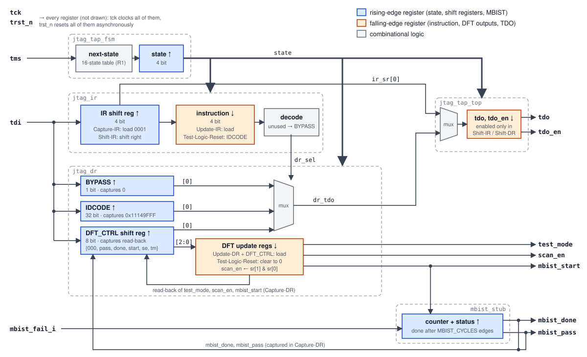

# JTAG TAP Controller: RTL, Formal Proof and UVM Verification

An IEEE 1149.1 test access port (TAP) with a private DFT control register, written in SystemVerilog and verified three ways:

1. **Formal (Questa PropCheck), done:** full (unbounded) proofs of the TAP state machine, the IR / DR protocol, the DFT register and the MBIST timing, with covers for every state and transition. No assumptions: every input is free, and `trst_n` can assert at any cycle. 63/63 assertions proven, 67/67 covers reached.
2. **UVM (QuestaSim), done:** a JTAG agent whose monitor rebuilds the TAP state from the pins on its own and feeds a reference-model scoreboard, so a driver bug cannot hide a DUT bug. Directed tests plus a random test with TCK stops and mid-scan `trst_n`, signed off on merged coverage over 20 seeds: 26/26 runs pass, 100 % functional coverage (87/87 bins), 100 % DUT code coverage.
3. **Mutation testing, done:** 21 injected bugs, each scored by Questa PropCheck and by black-box UVM. Every mutant is caught by at least one flow; each flow misses exactly one bug the other catches.

The full plan is in [docs/plan.md](docs/plan.md), the design rules in [docs/design_spec.md](docs/design_spec.md).

Same toolchain and flow as [axi4lite_uvm_questa](https://github.com/Snowy0521/axi4lite_uvm_questa).

## Status

| Part | State |
|---|---|
| Design specification ([docs/design_spec.md](docs/design_spec.md), rules R1–R23) | done |
| RTL (`rtl/`) | done |
| Lint (verilator `-Wall`, slang) | clean |
| Directed smoke test (iverilog) | passing |
| Formal properties and proofs (`formal/`) | done |
| UVM environment and regression (`tb/`) | done |
| Mutation testing (`mutations/`) | done |

## Design



**How a scan moves through the blocks** (blue registers change on the rising edge of TCK, orange ones on the falling edge):

1. **`jtag_tap_fsm`** steps through the 16 TAP states on every rising edge, driven only by TMS. Its `state` output tells every other block what to do in this cycle.
2. **IR scan (`jtag_ir`):** in Capture-IR the IR shift register loads `0001`; in Shift-IR it shifts TDI in and its bit 0 goes out on TDO. In Update-IR, on the falling edge, the shifted value becomes the active **instruction**. `decode` turns the instruction into `dr_sel`, which picks one data register; unknown opcodes pick BYPASS.
3. **DR scan (`jtag_dr`):** only the selected shift register captures and shifts. BYPASS captures 0, IDCODE captures the 32-bit ID, DFT_CTRL captures the current DFT outputs plus the MBIST status. The mux sends bit 0 of the selected register to the TDO stage.
4. **DFT write:** in Update-DR with DFT_CTRL selected, the falling edge copies the DFT_CTRL shift register into the **DFT update registers**, which drive `test_mode`, `scan_en` and `mbist_start` directly. `scan_en` is stored as `sr[1] & sr[0]`, so it can never be 1 without `test_mode`.
5. **`mbist_stub`:** while `mbist_start` is 1 it counts TCK cycles; after `MBIST_CYCLES` it sets `mbist_done`, with `mbist_pass = !mbist_fail_i`. The next DFT_CTRL capture reads both back.
6. **TDO stage:** on each falling edge, `tdo` takes bit 0 of the IR (in Shift-IR) or of the selected DR (in Shift-DR), and `tdo_en` is 1 only in those two states. The tester samples TDO on the next rising edge.
7. **Reset:** `trst_n` clears everything asynchronously. Reaching Test-Logic-Reset with TMS (five cycles of TMS = 1 from any state) has the same effect on the next falling edge: instruction = IDCODE, DFT outputs = 0, so the chip is back in functional mode.

Instructions: BYPASS (`1111`), IDCODE (`0001`, default after reset) and the private DFT_CTRL (`1000`); every other opcode behaves as BYPASS. EXTEST and SAMPLE/PRELOAD are mandatory in IEEE 1149.1 but not implemented yet (boundary scan is a planned extension), so the design does not claim full 1149.1 compliance. Register maps and all rules: [docs/design_spec.md](docs/design_spec.md).

## How to run

All targets run from the repository root; outputs go to `build/`. Run `make check` (every local flow, about a minute) before each commit; `make regress-questa` is the sign-off on the Questa machine.

| Command | Tools | What it does |
|---|---|---|
| `make lint` | Verilator, slang | Lint the RTL (`rtl/rtl.f`) |
| `make smoke` | Icarus Verilog | Directed smoke test `tb/tb_smoke.sv`: reset, IDCODE, BYPASS, unused opcode, DFT writes, MBIST pass / fail / restart, TMS reset, mid-scan `trst_n` |
| `make gen` | Python | Regenerate the per-arc state-machine checks from the spec's state table |
| `make props-sim` | Verilator | Run the formal properties in a random simulation (local sanity check, not a proof) |
| `make formal` | Questa Formal | Prove all properties (`formal/run_formal.tcl`) |
| `make uvm TEST=<test> SEED=<n>` | Verilator + UVM 1800.2-2020 | Run a UVM test locally (development; sign-off runs on Questa) |
| `make sim TEST=<test> SEED=<n>` | QuestaSim + UVM 1.2 | Run a UVM test with functional and DUT code coverage (`build/cov/<test>_<seed>.ucdb`) |
| `make sim-directed` | QuestaSim + UVM 1.2 | Run every directed test once (one build) |
| `make regress SEEDS=<n>` | Verilator | Every directed test + the random test on seeds 1..n: pass / fail table, merged functional coverage (TB counters), seed check (`build/regress/summary.md`) |
| `make mutate [ONLY=M05,M16]` | Verilator, or QuestaSim if there is no Verilator (+ Questa Formal if available) | Mutation testing: each bug in `mutations/` in a throwaway copy, equivalence check, scored by black-box UVM and by formal (`build/mutation/summary.md`) |
| `make regress-questa SEEDS=<n>` | QuestaSim | The same, plus `vcover merge` of all runs: covergroup and RTL code coverage (sign-off) |
| `make clean` | | Remove `build/` |

The UVM bench runs unchanged on UVM 1.2 (QuestaSim) and UVM 1800.2-2020 (Verilator), and both simulation flows also run the formal checkers, bound into the DUT.  The open-source tools cannot run the formal proofs, and Verilator's functional coverage support is limited, so coverage sign-off runs on Questa.

## Results

**Formal (Questa PropCheck)**

| Assertions proven | Covers reached | Proof depth | Run time |
|---|---|---|---|
| 63 / 63 | 67 / 67 | full proof (unbounded) | 595 s (4 engines, Questa 2024.3) |

**UVM regression (QuestaSim)**

| Seeds passed | Directed tests passed | Merged functional coverage | Code coverage (stmt / branch / cond / expr) |
|---|---|---|---|
| 20 / 20 | 6 / 6 | 100 % (87 / 87 bins) | 100 % / 100 % / 100 % / 100 % |

`make regress-questa`, Questa 2024.3 with UVM 1.2; the random test covers 307–344 scans and 3 883–5 098 checked TDO bits per seed. The formal checkers run in every simulation too: all 63 assertions pass and all 67 formal covers are hit in the merged runs. No FSM code coverage: Questa does not extract the state machine (next states come from a function), and its 16 states and 32 arcs are covered by the `cg_arc` covergroup, the formal covers and the per-arc proofs instead ([docs/plan.md](docs/plan.md) §3.5).

**Mutation testing**

| Mutations | Caught by formal | Caught by simulation | Caught by both | Missed |
|---|---|---|---|---|
| 21 | 20 / 21 | 20 / 21 | 19 | 0 |

`make mutate` with Questa 2024.3: PropCheck and `make regress-questa SEEDS=5`. All 21 mutants change behaviour (none is equivalent). Simulation is scored black-box (UVM without the formal checkers bound in). Each flow misses one bug:

- **M5, only formal** (the instruction also updates during Shift-IR): every exit from Shift-IR passes Update-IR, which loads the same final value, so nothing at the pins differs; the white-box property `a_ir_stable` sees it.
- **M21, only simulation** (TDO returns to zero while TCK is high, `tdo = tck ? 0 : tdo_q`): the bug is a change inside one clock phase, with TCK used as data. PropCheck models `tck` as an ideal clock that is only sampled at its edges, so `a_tdo_no_rise_change` is proven on the mutant (without a warning); the UVM monitor's edge check sees the change in the event-driven simulation. Formal results only hold for logic in which the clock reaches clock pins only.

Per-mutant details (first failing test, fired assertions): `make mutate` → `build/mutation/summary.md`.

## Repository layout

```
jtag_tap_verif/
├── README.md
├── LICENSE                  MIT
├── Makefile                 every flow (see How to run)
├── docs/
│   ├── design_spec.md       rules R1–R23, traceability to checks and mutations
│   ├── plan.md              verification plan
│   └── img/                 block diagram and timing diagram (SVG)
├── rtl/
│   ├── rtl.f                file list (repo-root-relative)
│   ├── jtag_pkg.sv          state encoding, opcodes, IDCODE, IR decode
│   ├── jtag_tap_fsm.sv      16-state TAP controller
│   ├── jtag_ir.sv           instruction register
│   ├── jtag_dr.sv           BYPASS, IDCODE, DFT_CTRL registers
│   ├── mbist_stub.sv        MBIST stand-in
│   └── jtag_tap_top.sv      top level, TDO stage
├── formal/                  formal harness, checkers, Questa run script
├── mutations/               one patch per injected bug (M01–M21)
├── scripts/
│   ├── gen_fsm_props.py     spec state table → per-arc checks
│   ├── regress.py           regression: directed + random seeds, merged coverage
│   └── run_mutations.py     mutation testing
└── tb/                      UVM testbench (agent, monitor, sequences, tests), tb_smoke.sv directed smoke test
```

## References

- IEEE Std 1149.1-2013, *Standard for Test Access Port and Boundary-Scan Architecture*.
- IEEE Std 1500-2005 (embedded core test) and IEEE Std 1687-2014 (IJTAG): background.
- [axi4lite_uvm_questa](https://github.com/Snowy0521/axi4lite_uvm_questa): the Questa formal / UVM flow this project reuses.

## License

[MIT](LICENSE)
