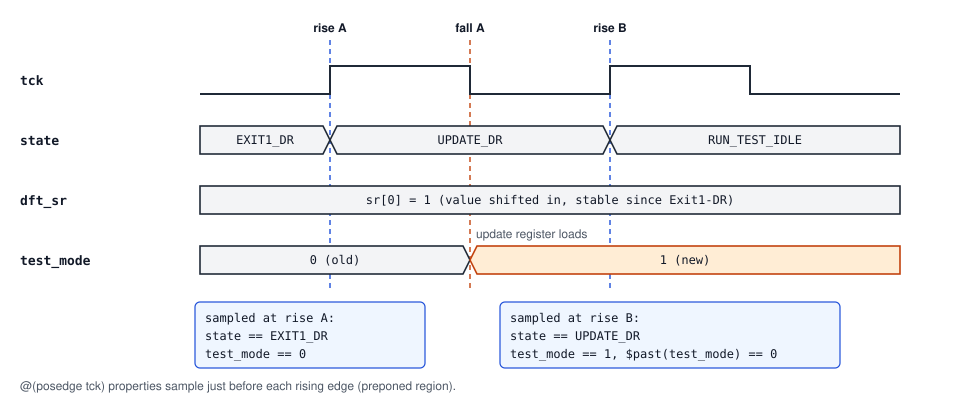

# Verification plan

How the design in [design_spec.md](design_spec.md) is verified. Overview, how to run and results: [README.md](../README.md).

---

## 1. Sampling conventions

The clock edge of every register is in spec §2. This section fixes how the checkers and monitors sample them.

**What a `@(posedge tck)` assertion sees.** SVA samples in the preponed region, i.e. the values just *before* the rising edge. Example: a DFT write in Update-DR.



So the update rule is written **without `$past` on the state**:
`$changed(test_mode) |-> (state == UPDATE_DR && ir == OP_DFT_CTRL) || state == TEST_LOGIC_RESET`.
The same holds for the IR update register (Update-IR) and for the Test-Logic-Reset clear: at the first rising edge *after* entering Test-Logic-Reset, the sampled state is TLR and the update registers are already cleared, so `state == TEST_LOGIC_RESET |-> ir == OP_IDCODE` holds with no delay.

TDO: in the first Shift-xR cycle, the falling edge drives `tdo = shift[0]`; the next rising edge (still in Shift-xR) is where the tester samples it and where the DUT shifts. So at the *n*-th rising edge in Shift-xR, sampled `tdo` is bit *n−1* of the captured value. The formal checkers sample TDO at the rising edge (chosen over a `negedge tck` clock, so all data properties share one clock), and the edge-only properties in 2.2 check separately that TDO never changes on a rising edge.

---

## 2. Formal verification

Aim for the same sign-off as the AXI4-Lite project: **every assertion a full proof, every cover reached, no assumptions.** TMS, TDI, `trst_n` and `mbist_fail_i` are all free inputs (every input sequence is legal JTAG); the only constraint is qverify's reset init sequence. Symbolic variables need no constraint either (see the IDCODE check in 2.2).

**Checker conventions (apply to every file in `formal/`):**
- Every checker register (shadow registers, counters, reference state) has `trst_n` as its asynchronous reset and resets to the value the **spec** defines, never to whatever the RTL does.
- Every checker module starts with `` `include "jtag_checker_defaults.svh" ``: `default clocking cb @(posedge tck)` and an X-safe `default disable iff (trst_n !== 1'b1 || trst_seen !== 1'b0 || rst_seen !== 1'b1)`, so no property can forget its reset. `rst_seen` keeps every property off until `trst_n` has been asserted once (before that, a 4-state simulator has X everywhere); in formal it is the constant 1, and a simulation that never asserts `trst_n` ends with an error. `trst_seen` stays 1 from any `trst_n` assertion until the next rising edge, so a reset pulse that starts and ends between two rising edges still disables the attempts it interrupts. A property on another edge names its clock explicitly (e.g. `@(negedge tck)`); the default `disable iff` still applies. The async-reset checks (2.1) are deferred immediate assertions, which the defaults do not affect.
- Checker counters are wide enough to saturate at their limit (e.g. `$clog2(MBIST_CYCLES + 1)` bits) and stop there.

These matter because the sign-off run leaves `trst_n` free (`-auto_constraint_off`, 2.5): a mid-scan or mid-MBIST reset clears the DUT, and a checker that kept its state would fail falsely.

### 2.1 Blackbox FSM checks

In `formal/jtag_tap_fsm_props.sv`, plus `formal/jtag_fsm_arcs.svh`, which `scripts/gen_fsm_props.py` generates from the state table in the spec.

- **Independent next-state model:** a function `next_state(state, tms)` written separately from the RTL (straight from the spec's state table), and
  `a_next_state: assert property (@(posedge tck) disable iff (!trst_n) 1 |=> state == next_state($past(state), $past(tms)));`
- **Per-arc assertions and covers:** `scripts/gen_fsm_props.py` reads the spec's state table and generates `jtag_fsm_arcs.svh` with one assertion and one cover per arc (32 + 32), e.g.
  `a_arc_shift_dr_0: assert property (@(posedge tck) disable iff (!trst_n) (state == SHIFT_DR && !tms) |=> state == SHIFT_DR);`
  The covers are required for sign-off. The per-arc assertions duplicate `a_next_state`, but they name the exact broken arc in the mutation table, and the generator makes them free.
- **Reset reachability:**
  `a_tms5_reset: assert property (@(posedge tck) disable iff (!trst_n) tms[*5] |=> state == TEST_LOGIC_RESET);`
- **Async reset:** cannot live under `disable iff (!trst_n)`. Give it its own property, e.g. a deferred immediate assertion `assert final (trst_n || state == TEST_LOGIC_RESET);` (same for `ir == OP_IDCODE` and DFT outputs = 0 while `trst_n` is low).
- **Legal encoding:** the state register always holds one of the 16 legal values.

### 2.2 Register protocol checks

In `formal/jtag_reg_props.sv`.

- **IR:** `a_capture_ir_01` (Capture-IR loads `0001`), `a_ir_stable` (the instruction changes only in Update-IR or Test-Logic-Reset), `a_ir_update` (Update-IR loads the shifted value), `a_reset_idcode`.
- **Decode:** `a_decode_idcode`, `a_decode_dft`, `a_unused_is_bypass`, written independently of the RTL's decode function.
- **TDO:** `a_tdo_en` (`tdo_en` exactly in Shift-xR), `a_tdo_idle_zero`.
- **Async reset:** `a_trst_ir`, `a_trst_tdo` (deferred immediate assertions, see 2.1).
- **End-to-end scan model:** at each Capture-xR the checker records the register length and the value the **spec** says is captured (IR `0001`, IDCODE `0x11149FFF`, BYPASS 0, DFT_CTRL read-back with reserved bits 0). The expected values are written in the checker, not taken from the RTL package, so a wrong package constant cannot hide. Two **symbolic indices** make one proof cover every bit position:
  - `a_scan_data`: the TDO bit at shift `k` equals captured bit `k` (`k < length`). Covers IR capture, shift order (LSB first), IDCODE value, BYPASS 0, DFT read-back.
  - `a_scan_delay`: the TDO bit at shift `j + length` equals the TDI bit at shift `j`. Covers BYPASS (one-shift delay), IDCODE over-length scans and IR pass-through.

  `k` (5 bits) and `j` (6 bits) are registers that hold their value and have no reset under `QUESTA_FORMAL`, so formal picks any initial value: the same mechanism as `sym_idx` in the AXI project, and no range assumption is needed. In simulation they get new random values at every capture (constant within a scan), or are pinned with `+scan_k=` / `+scan_j=`.
  Covers `c_scan_data_last_*` and `c_scan_delay_*`, one per register (IR, BYPASS, IDCODE, DFT_CTRL), show that both properties are actually exercised for every register, not passing vacuously.
- **Edge checks (shadow registers):** `a_tdo_no_rise_change`, `a_tdo_en_no_rise_change`, `a_ir_no_rise_change`. Each falling-edge signal is copied at the rising edge (`$sampled`, so simulation also takes the pre-edge value), and a `@(negedge tck)` assertion checks it has not moved since. The shadows reset to the spec reset values, so a wrong reset value is caught rather than copied. TDO is sampled at the rising edge (section 1), so a data check alone cannot see on which edge TDO changed.

### 2.3 DFT and MBIST checks

In `formal/jtag_dft_props.sv`, with its own model of the DFT_CTRL shift register.

- **DFT register:** `a_dft_update_only` (outputs change only in a DFT_CTRL Update-DR or Test-Logic-Reset), `a_dft_write` (the value written, with `scan_en` gated by `test_mode`), `a_dft_reset_functional`, `a_trst_dft`, `a_scan_en_safe`. Read-back of the MBIST status and the reserved bits is checked by `a_scan_data` (2.2).
- **MBIST stub**, with `MBIST_CYCLES = 4` set from `formal_top`: `a_mbist_done_exact` (a checker counter of rising edges that sample `mbist_start = 1`; `mbist_done` exactly when it reaches `MBIST_CYCLES`), `a_mbist_clear`, `a_mbist_hold`, `a_mbist_pass_value`, `a_mbist_pass_needs_done`.
- **Edge check:** `a_dft_no_rise_change` for `test_mode`, `scan_en`, `mbist_start`. Not for `mbist_done` / `mbist_pass`: the stub runs on the rising edge.

### 2.4 Covers

Generated: all 16 states and all 32 arcs (2.1). In `formal/jtag_covers.sv`:

- `c_ir_scan_then_idcode_read`: an IR scan that loads IDCODE, then a full 32-bit read.
- `c_pause_dr`, `c_pause_ir`: a scan that pauses and returns to shifting.
- `c_scan_mode`, `c_mbist_pass_readback`, `c_mbist_fail`, `c_mbist_restart`, `c_tms_reset_from_test_mode`.
- `c_trst_mid_scan`: `trst_n` during a DR scan. It opts out of the default `disable iff`, which would otherwise switch it off exactly when it happens.

### 2.5 Questa Verify flow

`formal/formal_top.sv` instantiates the DUT and binds the checkers (`formal/jtag_binds.svh`, shared with the UVM bench); `formal/formal.f` lists the files; `formal/run_formal.tcl` runs the flow.

Before each Questa run, `make props-sim` runs the same checkers in a random Verilator simulation (`formal/props_sim.sv`). It is not a proof, but it catches compile errors and wrong properties locally. Verilator treats `assert final` as a plain immediate assertion, so the async-reset checks have a simulation-only variant under `ifdef VERILATOR`.

Based on the known-working `axi4lite_uvm_questa/sim/formal_questa.do`, which uses no `netlist` commands:

```tcl
onerror {exit 1}
vlib build/formal_work                ;# own library, separate from the simulation flow (vlog-13233)
vmap work build/formal_work
vlog -sv -timescale 1ns/1ps +define+QUESTA_FORMAL -f rtl/rtl.f -f formal/formal.f   ;# run from the repo root, see below
formal compile -d formal_top
formal verify -auto_constraint_off    ;# see below
formal generate report build/formal_report.txt
exit
```

**Reset:** by default qverify pins the reset inactive after its init sequence, which makes every `!trst_n |-> ...` property vacuous and never exercises mid-scan `trst_n` (confirmed in the AXI project's script comments). `-auto_constraint_off` makes `trst_n` a free input after init, so reset can hit at any cycle. This is the single sign-off run; the `disable iff (!trst_n)` properties still prove, and the async-reset properties become non-vacuous. Check the vacuity / cover results for the reset properties in the report.

**No no-assumption run:** the AXI project needed `formal-verify-noassume` because its environment had `assume property` constraints on the master. This environment has none (see the sign-off rule above), so that run would be identical to the main one and is dropped.

**File lists and run directory:** with `vlog -f` (and `verilator -f`, `iverilog -c`), relative paths inside a `.f` file resolve against the **current directory**, not the `.f` file's location. So every `.f` entry is written relative to the **repo root** (e.g. `rtl/jtag_pkg.sv`), and every flow (Makefile targets, `run_formal.tcl`, `regress.py`, `run_mutations.py`) runs with the repo root as its working directory. Libraries (`build/formal_work`, `build/questa_work`) and reports (`build/formal_report.txt`) go to `build/`. The Makefile exports `MODELSIM=$(CURDIR)/build/modelsim.ini`, as the AXI Makefile does, so `vmap` writes `modelsim.ini` there too. Tool scratch files that Questa always writes to the working directory (`transcript`, `.qverify/`, `propcheck.db/`) stay in the repo root; all are git-ignored. This works the same for all three tools, unlike `-F`, which iverilog does not offer in the same form.

**Results table in README.md:** number of assertions proven / total, covers reached / total, max proof depth, run time.

---

## 3. UVM environment

### 3.1 Transactions

All UVM files live in `tb/`; `tb/tb.f` lists them. Development runs locally under Verilator with UVM 1800.2-2020 (`make uvm TEST=… SEED=…`); the regression and coverage sign-off run on Questa.

Stimulus and observation are separate classes: the driver never fills in results, and the scoreboard never sees a driver object.

```systemverilog
// Driver stimulus (sequence item)
class jtag_seq_item extends uvm_sequence_item;
  typedef enum {IR_SCAN, DR_SCAN, RESET_TMS, RESET_TRST, IDLE, TCK_STOP} kind_e;
  rand kind_e        kind;
  rand int unsigned  len;          // random length; after randomize(), len == tdi_q.size()
       bit           tdi_q[$];     // shifted in, LSB first, what the driver uses (no 64-bit limit)
  rand bit           use_pause;    // go through Pause-xR mid-shift
  rand int unsigned  pause_at;     // shift index where the pause happens
  rand int unsigned  idle_cycles;  // also TCK-stopped cycles for TCK_STOP
  ...
endclass

// Monitor result (analysis transaction), built only from pin activity
class jtag_scan_txn extends uvm_sequence_item;
  typedef enum {IR, DR} scan_e;
  scan_e        scan;
  tap_state_e   path[$];           // observed state sequence of the scan
  bit           tdi_q[$];
  bit           tdo_q[$];
  bit           aborted;           // ended by trst_n low before Update-xR
  ...
endclass
```

`len` exists only because random queue sizes are poorly supported by some simulators: `len` is randomized, `post_randomize` fills `tdi_q`, and if a sequence pre-filled `tdi_q`, its size wins. A pause that does not fit the scan is a fatal error, in `post_randomize` and in the driver, so it can never be skipped silently.

### 3.2 Components

- **TCK source:** a free-running clock in `tb_top`, gated by `tck_en` in `jtag_if`. The driver drops `tck_en` (only while TCK is low, so no glitch) for `TCK_STOP` items. A stopped TCK is legal JTAG; the monitor checks that the TAP state, `tdo` and the DFT outputs do not change while TCK is stopped, and the scoreboard checks that the next scan after the stop is still correct.
- **Driver:** tracks the TAP state itself and generates the TMS path for each item, e.g. IR_SCAN from Run-Test/Idle = `1,1,0,0` → shift `tdi_q.size()` bits (TMS = 1 on the last bit) → `1` (Update-IR) → `0` (Run-Test/Idle). Drive TMS/TDI on the falling edge so they are stable at the rising edge.
- **Formal checkers in simulation:** both simulation flows bind the formal checker modules into the DUT (same binds as `formal_top.sv`), so the UVM stimulus also drives every property, including the white-box ones. A failing property fails the run.
- **Sampling:** both monitors read pins through clocking blocks with `#1step` input skew, so they see the values just before the rising edge in every simulator, even for an output that changes in the edge's own time step.
- **JTAG monitor:** reconstructs the TAP state **independently** from TMS (its own copy of the spec's state table, not the driver's), collects TDI/TDO bits during Shift states and publishes `jtag_scan_txn`s. Flag a protocol error if `tdo_en` is high outside Shift states, or if `tdo` / `tdo_en` change while `tck` is high (i.e. not at a falling edge; changes caused by `trst_n` are ignored). On `trst_n` low mid-scan, it publishes the partial scan with `aborted = 1` and resets its state. (Only `trst_n` can abort a scan: via TMS, every path out of Shift-xR / Pause-xR passes Exit → Update before Test-Logic-Reset, so the scan always completes first.)
- **DFT monitor:** a passive monitor on `dft_if` that samples the DFT pins at every rising edge of TCK and publishes them stamped with the edge number. Both monitors count TCK edges the same way, so the scoreboard lines up their messages by cycle, not by arrival order (they fire on the same edge). It flags an error if `test_mode` / `scan_en` / `mbist_start` change while `tck` is high (ignoring `trst_n` clears), the simulation counterpart of the formal edge-only properties.
- **Reference model:** predicts the active instruction, BYPASS / IDCODE / DFT_CTRL contents, TDO streams and DFT output changes, including the "unused opcode = BYPASS" and "reset = IDCODE" rules. It is fed **only by the monitors, never by the driver** (stated in the code comments too): this is why a driver bug cannot hide a DUT bug.
- **Scoreboard:** compares every observed TDO stream and every DFT output change against the model. In `check_phase`, report any scan that started but never completed; scans that ended with `aborted = 1` count as complete, so a mid-scan `trst_n` in `jtag_random_test` does not false-fail.
- **Timeouts:** fail fast if a sequence hangs, as in the AXI project.

### 3.3 Sequences and tests

| Test | What it checks |
|---|---|
| `jtag_reset_test` | `trst_n`, five-TMS reset, reset from every state |
| `jtag_idcode_test` | IDCODE after reset without loading an instruction, and after explicitly loading it |
| `jtag_bypass_test` | BYPASS with random-length streams; 1-cycle delay; first bit 0 |
| `jtag_unused_opcode_test` | every unused opcode behaves like BYPASS |
| `jtag_dft_test` | test mode entry, MBIST start, poll `mbist_done`, read pass/fail, reset back to functional mode |
| `jtag_pause_test` | IR and DR scans interrupted by Pause-xR / Exit2-xR loops |
| `jtag_random_test` | random mix of all items, random idle cycles, TCK stops, occasional mid-scan `trst_n` |

### 3.4 Functional coverage

- TAP state × TMS (= all 32 arcs), sampled in the monitor.
- Opcode loaded: each defined instruction + "unused" bin.
- DR scan length: `< length`, `== length`, `> length` for each selected register.
- Pause usage: no pause, pause in IR, pause in DR, multiple pauses.
- DFT: `test_mode` × `scan_en` × `mbist_start`. The `illegal_bins` for `scan_en && !test_mode` duplicates `a_scan_en_safe`: it is counted as a **check**, not as a coverage goal, and is excluded from the coverage percentage.
- MBIST: run completed with pass, with fail, restart (write 0 then 1), redundant write of 1 while running.
- Reset kind × state at reset time; mid-scan reset (aborted scans).

### 3.5 Regression

- `scripts/regress.py`: 20 seeds × `jtag_random_test`, plus every directed test once. Merge coverage with `vcover merge` and sign off on **merged** coverage (same rule as the AXI project).
- Check that the seed is really applied: merged coverage should differ from each per-seed result. The AXI project found that bug the hard way.
- Collect DUT code coverage (statements, branches, conditions, FSM states/transitions). Treat any gap as a hole in the verification plan, and close unreachable terms with formal covers. Known exclusion: the FSM `default` branch in `jtag_tap_fsm.sv` is unreachable by R4 (all 16 codes are states) and is wrapped in `// coverage off` / `// coverage on`; every exclusion is listed here with its reason.

---

## 4. Mutation testing

One patch per bug in `mutations/`. Run each against formal and UVM, then record which flow caught it:

| # | Mutation | Expected to be caught by |
|---|---|---|
| M1 | Exit2-DR with TMS = 0 goes to Update-DR instead of Shift-DR | FSM arc assertion; pause test |
| M2 | Select-IR-Scan with TMS = 1 goes to Run-Test/Idle instead of Test-Logic-Reset | `a_tms5_reset` |
| M3 | Capture-IR loads `2'b00` | `a_capture_ir_01`; scoreboard |
| M4 | TDO updated on the rising edge | `a_tdo_no_rise_change`; JTAG monitor edge check |
| M5 | IR updates during Shift-IR | `a_ir_stable` (formal, and in simulation with the checkers bound into the DUT). Not visible at the pins in this design (every exit from Shift-IR passes Update-IR, and no output depends on the instruction outside DR scans), so no black-box check can see it; with boundary scan (EXTEST driving pins) it would be |
| M6 | Reset leaves BYPASS active instead of IDCODE | `a_reset_idcode`; idcode test |
| M7 | Unused opcode selects IDCODE | `a_unused_is_bypass`; unused opcode test |
| M8 | `scan_en` not gated by `test_mode` | `a_scan_en_safe` |
| M9 | DFT outputs not cleared in Test-Logic-Reset | `a_dft_reset_functional`; dft test |
| M10 | DR shift direction reversed (MSB first) | `a_scan_data`; idcode test |
| M11 | BYPASS captures 1 | `a_scan_data`; bypass test |
| M12 | One wrong IDCODE bit (e.g. bit 17) | `a_scan_data` (symbolic `k`); idcode test |
| M13 | DFT update fires with any instruction active | `a_dft_update_only`; DFT monitor + scoreboard |
| M14 | Reserved bits 7:5 writable (read back what was written) | `a_scan_data`, `a_dft_write`; dft test |
| M15 | `tdo_en` also high in Exit1-xR | `a_tdo_en`; monitor protocol check |
| M16 | `trst_n` does not reset the IR (only the TLR falling-edge clear does) | `a_trst_ir`, IR shadow register (need `-auto_constraint_off`); reset test: short `trst_n` pulse with TMS = 0, so no falling edge happens in Test-Logic-Reset |
| M17 | Update registers clocked on the rising edge | edge checks (2.2, 2.3), `a_dft_write`; DFT monitor edge check |
| M18 | `mbist_done` one edge early (`MBIST_CYCLES - 2` in the compare) | `a_mbist_done_exact`; exact-count check in dft test / smoke |
| M19 | `mbist_done` is a pulse, not held while `mbist_start` = 1 | `a_mbist_hold`; dft test |
| M20 | `mbist_pass` re-sampled from `mbist_fail_i` after done | `a_mbist_hold`; dft test |
| M21 | TDO returns to zero while TCK is high (combinational; correct at every rising-edge sample) | `a_tdo_no_rise_change`; JTAG monitor edge check. No data check can see it |

M1–M9 are mostly control / FSM bugs; M10–M17 and M21 cover the data path and the edge timing; M18–M20 cover the MBIST stub. The goal is a table in README.md showing which flow caught each of the **21 mutations**. M16 needs a specific stimulus in simulation (a short `trst_n` pulse followed directly by TMS = 0); a result worth reporting either way. Any other miss points to a missing check, so add it.

**Mutant sanity check (`run_mutations.py`):** before scoring, confirm that each mutant applies cleanly, compiles, and actually changes behaviour (e.g. a short directed run whose trace differs from the clean RTL, or at least one formal assertion that differs). An equivalent mutant would otherwise show up as falsely "missed". Patches are applied and reverted with `git apply` / `git apply -R`.

---

## 5. Stretch goals

1. **Boundary scan:** an N = 4 pin boundary scan register with SAMPLE/PRELOAD and EXTEST, plus properties that EXTEST drives the pins from the update latches and that functional mode is unaffected otherwise.
2. **CDC version of the MBIST stub:** run the MBIST engine on a separate system clock, add a 2-flop synchronizer for `mbist_start` / `mbist_done`, and discuss what formal can and cannot say about it.
3. **Multi-TAP chain:** two TAP instances in series. The UVM test selects one device (the other in BYPASS) and checks the chain length.
4. **BSDL file:** a BSDL description of the device. This is how real JTAG tools learn the IR length, opcodes and IDCODE.
5. **IEEE 1687 (IJTAG) taster:** one segment insertion bit (SIB) in front of the DFT_CTRL register.

---

## 6. Phases and exit criteria

| Phase | Work | Done when |
|---|---|---|
| Phase 1 | Specification (`design_spec.md`), RTL, lint, directed smoke test | Lint clean, smoke test passing |
| Phase 2 | Formal: FSM, register, DFT and MBIST properties, covers, Questa flow | Every assertion proven, every cover reached |
| Phase 3 | UVM: agent, monitors, reference model, scoreboard, coverage, tests, regression | 20/20 seeds pass, 100 % merged functional coverage, code coverage reviewed |
| Phase 4 | Mutation testing, results tables in README.md | All 21 mutations scored per flow, README results complete |
